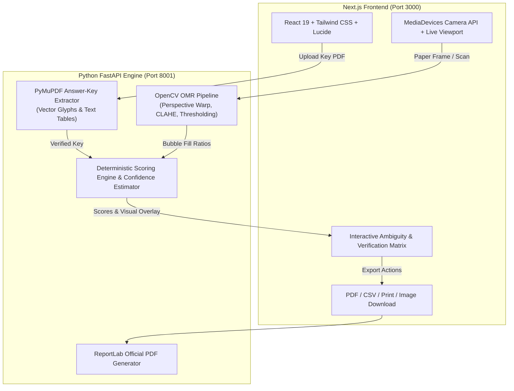

# ScanGrade OMR — AI-Assisted Answer Sheet Scanner and Automatic Grading System

> **Designed for the Aeronautical Information Service Comprehensive Course (AISCC) & Standardized Examinations**

ScanGrade OMR is a web-based, deterministic Optical Mark Recognition (OMR) application and examination grading system. It allows examination administrators and proctors to upload an answer-key PDF, capture physical answer sheets via webcam, mobile camera, or scanned files, perform perspective correction and bubble alignment using OpenCV, and instantly calculate official scores and section breakdowns with confidence metrics.

**Zero Database Required**: All processing runs in-memory with transient file handling. No user accounts, credentials, or student papers are permanently stored.

---

## System Architecture



---

## Key Features

1. **Answer-Key Ingestion**:
   - **Vector Extraction**: Automatically extracts glyphs and options directly from vector PDFs (such as the CAAP AISCC Batch 02 Qualifying Examination 160-question sheet).
   - **Tabular & Text Parsing**: Parses numbered list keys (e.g. `1. A, 2. B`) and table structures.
   - **1-Click Preloaded Sample**: Instantly load the 160-question AISCC Qualifying Exam key for immediate testing.
   - **Pre-Grading Verification**: Edit or void any question in the verification matrix before scanning.

2. **Computer Vision & OMR Pipeline**:
   - **4-Point Perspective Transform**: Automatically identifies paper boundaries and warps tilted/skewed paper into a standardized flat canvas.
   - **CLAHE Illumination Compensation**: Balances uneven camera shadows, flash glare, and dim ambient lighting.
   - **Inner ROI Sampling**: Samples the inner 60% of each bubble or square checkbox to eliminate border ink bias.
   - **Multi-Mark & Smudge Detection**: Identifies ambiguous marks, double-shaded bubbles, and weak pencil erasures, flagging them for human review.
   - **Visual Annotated Overlay**: Generates a high-resolution color-coded visual overlay (Green = Correct, Red = Incorrect, Dotted Green = Answer Key, Amber = Ambiguous).

3. **Examination Scorecard & Analytics**:
   - Total score and percentage breakdown.
   - Subject / Section progress bars (e.g. *General Information*, *Logical Reasoning*, *Mathematics*, *English*).
   - Detailed question-by-question comparison table with search and status filters.
   - Real-time inline score recalculation: Click any student answer to adjust and update the score dynamically.

4. **Multi-Format Export**:
   - Download Official Examination PDF Report (generated via ReportLab).
   - Export Question-by-Question Results to CSV.
   - Browser Print-Optimized Layout (`window.print()`).
   - Download High-Resolution Annotated Scanned Paper Image.

---

## Technology Stack

- **Frontend**: Next.js 16 (App Router), React 19, TypeScript, Tailwind CSS, Lucide Icons, Canvas Confetti.
- **Backend**: Python 3.12, FastAPI, Uvicorn, Pydantic v2.
- **Computer Vision & Image Processing**: OpenCV (`opencv-python`), NumPy.
- **Document Processing**: PyMuPDF (`pymupdf`), ReportLab (`reportlab`).
- **Testing**: `pytest`, `httpx`, `fastapi.testclient`.

---

## Project Structure

```
AISCC_SCANNER/
├── backend/
│   ├── app/
│   │   ├── main.py                     # FastAPI application endpoints & CORS
│   │   ├── models.py                   # Pydantic schemas (AnswerKey, Question, GradingResult)
│   │   ├── services/
│   │   │   ├── pdf_extractor.py        # PyMuPDF vector & text parser
│   │   │   ├── omr_engine.py           # OpenCV perspective warp, alignment & fill ratio logic
│   │   │   ├── grading_service.py      # Scoring calculations, sections, and manual overrides
│   │   │   └── exporter.py             # ReportLab PDF & CSV generators
│   │   └── templates/
│   │       ├── aiscc_160.py            # AISCC 4-column 160-question geometry
│   │       └── standard_templates.py   # 50-q & 100-q standard templates
│   ├── sample_data/
│   │   ├── AISCC_Batch_02_Answer_Key.pdf  # Sample answer key PDF
│   │   └── sample_answer_key_300dpi.png   # Sample high-res answer sheet image
│   └── tests/
│       ├── test_api.py                 # FastAPI integration tests
│       ├── test_grading_service.py     # Scoring and correction tests
│       ├── test_omr_engine.py          # OMR detection, blanks, multiple marks, rotation
│       └── test_pdf_extractor.py       # PDF key extraction validation
├── frontend/
│   ├── src/
│   │   ├── app/
│   │   │   ├── globals.css             # Tailwind CSS styling
│   │   │   ├── layout.tsx              # Root HTML & fonts
│   │   │   └── page.tsx                # Master 5-step workflow container
│   │   ├── components/
│   │   │   ├── Navbar.tsx              # Header with reset session modal & theme toggle
│   │   │   ├── StepProgress.tsx        # 5-step navigation stepper
│   │   │   ├── Step1UploadKey.tsx      # PDF answer key upload & sample loader
│   │   │   ├── Step2VerifyKey.tsx      # Answer key verification matrix
│   │   │   ├── Step3ScanSheet.tsx      # Webcam capture & file dropzone
│   │   │   ├── Step4ReviewDetection.tsx# Ambiguity & smudge verification
│   │   │   └── Step5Results.tsx        # Scorecard, section breakdown, overlay & exports
│   │   └── types/
│   │       └── grading.ts              # TypeScript interfaces
│   └── next.config.ts                  # API proxy rewrite to port 8001
└── README.md
```

---

## Quick Start & Local Development

### 1. Backend Setup

```bash
# Navigate to backend directory
cd backend

# Create virtual environment (if not already created)
python -m venv venv

# Activate virtual environment
# Windows:
.\venv\Scripts\activate
# Linux/macOS:
source venv/bin/activate

# Install dependencies
pip install opencv-python numpy pymupdf pillow fastapi uvicorn python-multipart pytest httpx reportlab

# Start FastAPI server on port 8001
python -m uvicorn app.main:app --host 127.0.0.1 --port 8001 --reload
```

The backend API will be live at `http://127.0.0.1:8001` (Interactive Swagger docs available at `http://127.0.0.1:8001/docs`).

### 2. Frontend Setup

```bash
# Navigate to frontend directory
cd frontend

# Install npm dependencies
npm install

# Run the development server
npm run dev
```

Open `http://localhost:3000` in your web browser.

---

## Automated Test Suite

Run the comprehensive automated test suite covering scoring logic, blank responses, multiple-mark disambiguation, image rotation, and PDF parsing:

```bash
# From the project root with the virtual environment activated:
.\backend\venv\Scripts\python -m pytest backend/tests -v
```

**Test Coverage**:
- `test_api.py`: Health check, template listing, sample key extraction, scan & grade endpoint, CSV/PDF generation.
- `test_grading_service.py`: Perfect score calculation, partial score with blanks/ambiguous answers, real-time manual correction recalculation.
- `test_omr_engine.py`: Synthetic sheet mark classification, double-marked detection, blank handling, 90°/180°/270° image rotation.
- `test_pdf_extractor.py`: AISCC Batch 02 PDF extraction across 160 questions, text-based answer key parsing.

---

## Deployment Guidelines

### Frontend (Vercel)
1. Push the repository to GitHub.
2. Import the `frontend` folder into [Vercel](https://vercel.com).
3. Set the environment variable:
   - `NEXT_PUBLIC_BACKEND_URL`: URL of your deployed Python FastAPI service (e.g. `https://your-api.onrender.com`).
4. Deploy.

### Backend (Render / Railway / Cloud Run)
1. Create a `Procfile` or `Dockerfile`:
   ```dockerfile
   FROM python:3.12-slim
   RUN apt-get update && apt-get install -y libgl1-mesa-glx libglib2.0-0
   WORKDIR /app
   COPY backend/ /app/backend/
   RUN pip install --no-cache-dir -r backend/requirements.txt
   CMD ["uvicorn", "backend.app.main:app", "--host", "0.0.0.0", "--port", "8000"]
   ```
2. Deploy to any containerized host (Render, Railway, Fly.io, Google Cloud Run).
